# Little Lemon Database Engineer Capstone Project

This project covers the complete end-to-end database implementation for Little Lemon restaurant, including database modeling, stored procedures, Python connector integration, and Tableau data visualizations.

---

## 1. Database Model & ER Diagram
The database structure and entity-relationship diagram (ERD) created for the Little Lemon project.

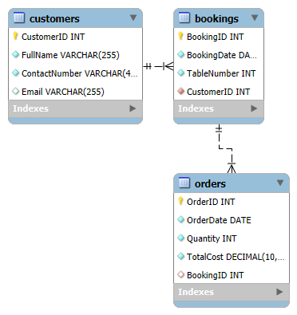

---

## 2. Stored Procedures & Python Outputs
Outputs for the required SQL stored procedures and Python database connection tests:

* **GetMaxQuantity Output:**
  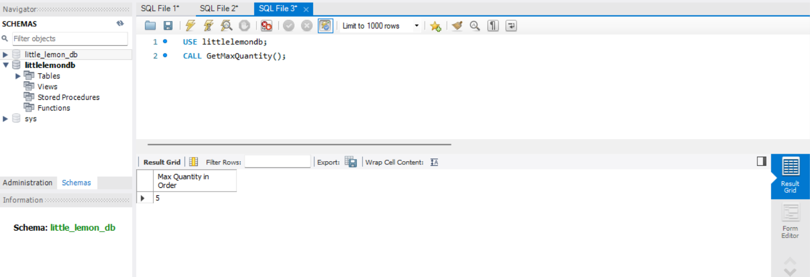

* **AddBooking Output:**
  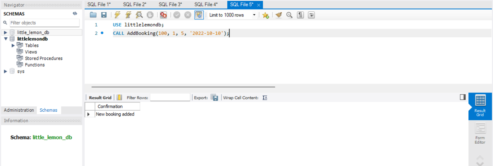

* **UpdateBooking Output:**
  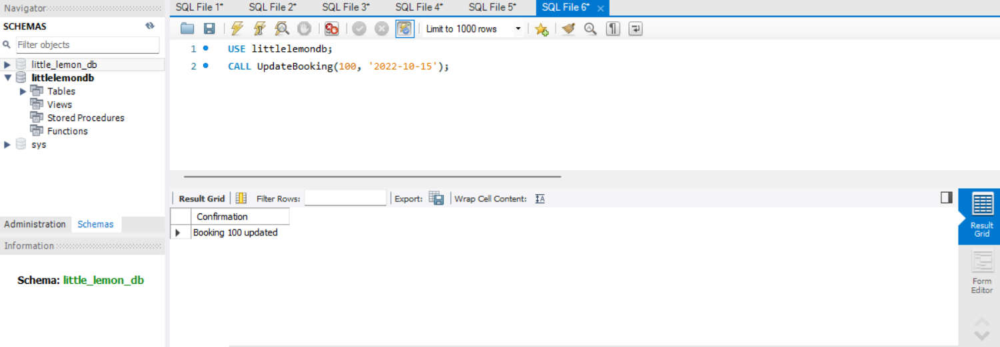

* **ManageBooking Output:**
  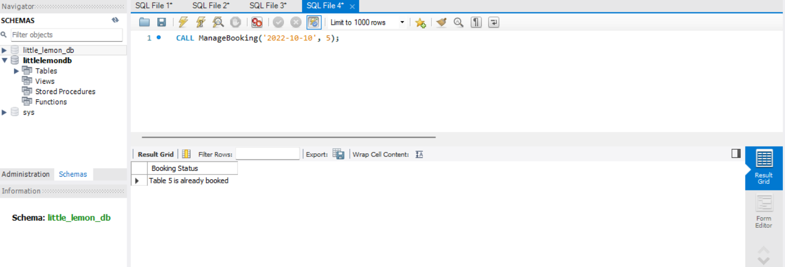

* **CancelBooking Output:**
  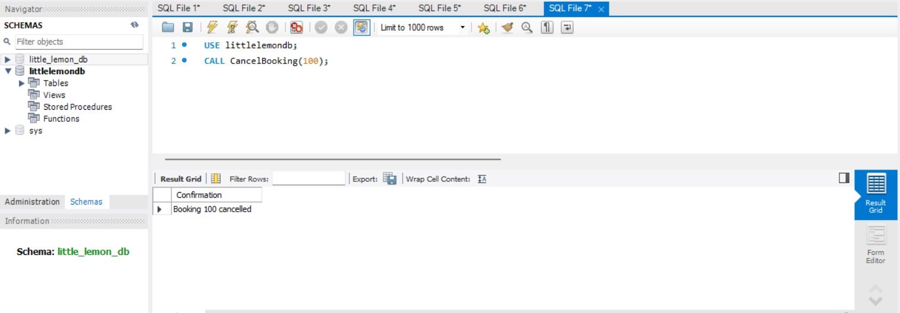

* **Python Integration Output:**
  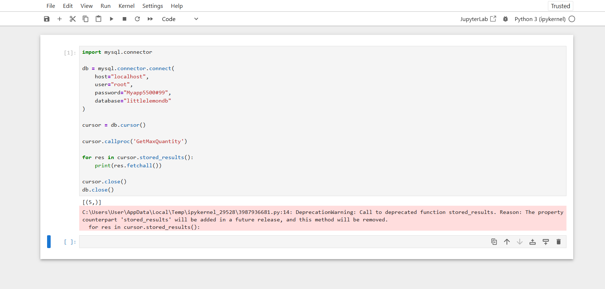

---

## 3. Tableau Visualizations & Dashboard
Data visualizations and the final consolidated dashboard created in Tableau:

* **Customer Sales:**
  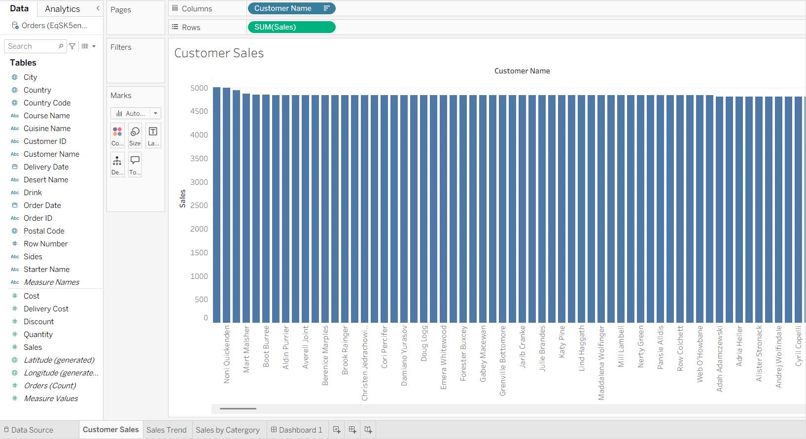

* **Sales Trend:**
  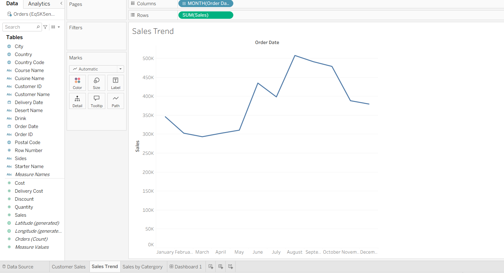

* **Sales by Category:**
  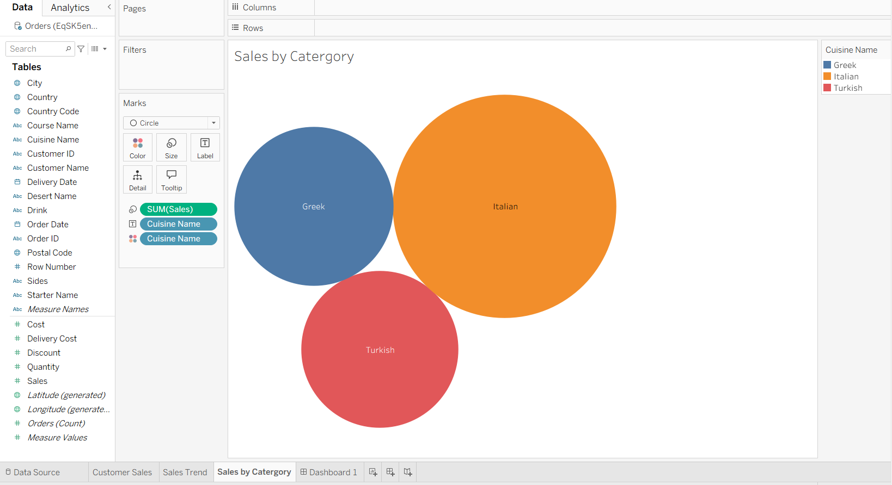

* **Dashboard Overview:**
  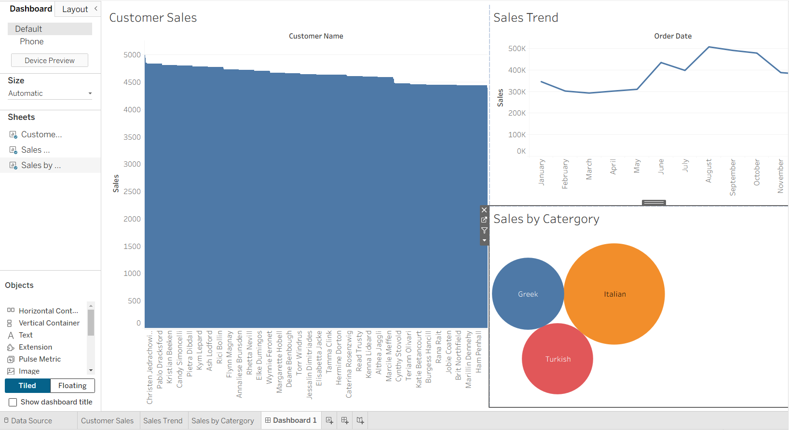
